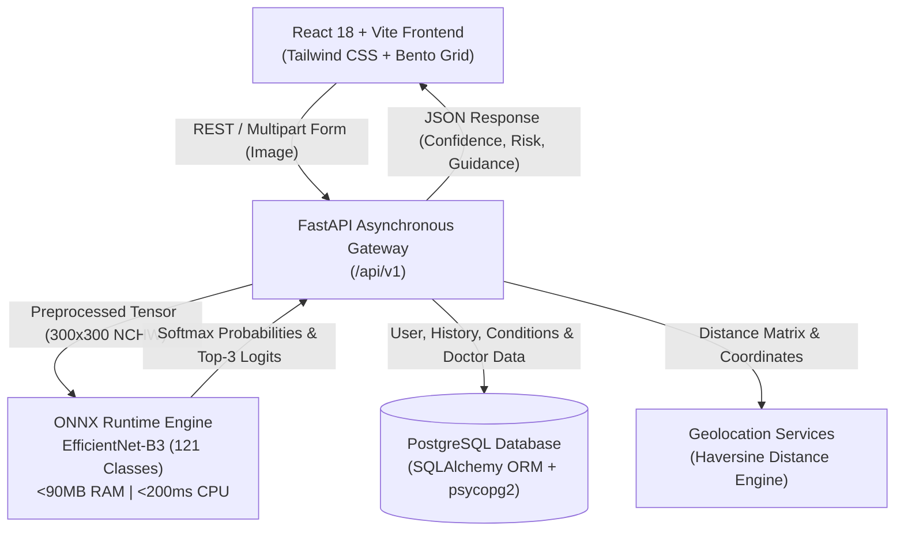

# DermAI 🩺
### Next-Generation AI-Powered Skin Disease Detection, Progression Tracking & Clinical Triage

[](https://fastapi.tiangolo.com/)
[](https://react.dev/)
[-005CED?style=flat-square)](https://onnxruntime.ai/)
[-FF6F00?style=flat-square)](https://arxiv.org/abs/1905.11946)
[](https://www.postgresql.org/)
[](https://tailwindcss.com/)
[](https://www.docker.com/)

---

## 📌 Executive Overview

**Derm-AI** is a full-stack, clinical-grade dermatology screening and triage platform built to bridge the gap between early symptom detection and professional specialist care. 

In traditional digital healthcare, individuals seeking answers about skin irregularities either face long clinical waiting lists or fall victim to alarming, inaccurate online search results. Furthermore, many existing dermatology computer vision models suffer from severe algorithmic bias, performing poorly on deeply pigmented skin.

**Derm-AI solves this through:**
1. **Algorithmic Skin Tone Equity:** Explicitly trained on datasets categorized across all six **Fitzpatrick Skin Phototypes (Types I–VI)**.
2. **Instant Computer Vision Inference:** Sub-second classification across **121 dermatological conditions** using an ultra-lightweight **EfficientNet-B3** model compiled with **ONNX Runtime**.
3. **End-to-End Patient Journey:** Goes beyond raw predictions by providing an interactive **clinical symptom checker**, **longitudinal photo progression tracking**, **multilingual voice explanations**, and a **hyperlocal doctor finder** connecting users directly to verified board-certified dermatologists.

---

## ✨ Key Features & Capabilities

### 🔬 1. AI Visual Lesion Classification (121 Classes)
- **Top-3 Differential Diagnoses:** Provides primary and secondary candidates with percentage confidence scores, aligning with real-world dermatological clinical practice.
- **Risk Stratification:** Categorizes findings into **High Risk** (e.g., Melanoma, Squamous Cell Carcinoma, Basal Cell Carcinoma), **Medium Risk**, or **Low Risk**, advising immediate clinical consultation when necessary.
- **Ultra-Lightweight Inference:** Transformed from PyTorch to an ONNX static computation graph, reducing inference memory usage to **< 90 MB RAM** with CPU execution times **< 200 ms**.

### 🎨 2. Diagnostic Fairness Across the Fitzpatrick Scale
- Trained on the benchmark **Fitzpatrick 17k** dataset (114 conditions spanning Phototypes I through VI) and **HAM10000** (7 pigmented lesion classes).
- Mitigates diagnostic disparities across light, olive, and deeply pigmented skin tones.

### 📋 3. Interactive Clinical Symptom Checker
- A step-by-step diagnostic interview wizard collecting essential patient history:
  - Anatomic lesion location.
  - Duration and onset speed.
  - Sensation (itching, burning, pain, bleeding).
  - Morphological evolution (changes in size, shape, or color).
- Compiles an exportable **Clinical Summary** that patients can present directly to a physician.

### 📈 4. Longitudinal Photo Progression Tracking
- Monitor skin conditions over days, weeks, or months.
- Compare side-by-side progression photos to visually evaluate whether a condition is responding to treatment, stabilizing, or worsening.

### 📍 5. Hyperlocal Dermatologist Finder
- Interactive map and directory utilizing the **Haversine formula** and browser geolocation.
- Filters verified local clinics and dermatologists by distance, consultation fees, and ratings.

### 🌐 6. Multilingual Accessibility & Voice Explanations
- Localized across multiple regional languages including **English, Hindi, and Marathi**.
- Integrated text-to-speech voice explainer translating complex medical terminology into clear, accessible audio descriptions.

### 🔐 7. Secure Authentication & User Profiles
- JWT (JSON Web Tokens) authentication with secure password hashing (`bcrypt`).
- Customizable profiles with saved Fitzpatrick skin type, preferred language, and diagnostic history.

---

## 🏗️ System Architecture



---

## 🧠 Machine Learning Details

### Architecture & Preprocessing
* **Base Architecture:** `EfficientNet-B3` with Compound Scaling and Mobile Inverted Bottleneck Convolutions (MBConv).
* **Input Resolution:** `300 × 300` RGB pixels.
* **Normalization:** ImageNet distribution ($\mu = [0.485, 0.456, 0.406]$, $\sigma = [0.229, 0.224, 0.225]$).
* **Tensor Layout:** Channels-first `[Batch, 3, 300, 300]` in single-precision `float32`.

### Datasets
1. **Fitzpatrick 17k (114 Classes):** Spans all 6 Fitzpatrick skin types to enforce fair representation across diverse ethnic demographics.
2. **HAM10000 (7 Classes):** 10,000 high-resolution dermoscopic images covering Melanoma (MEL), Melanocytic Nevi (NV), Basal Cell Carcinoma (BCC), Actinic Keratoses (AKIEC), Benign Keratoses (BKL), Dermatofibroma (DF), and Vascular Lesions (VASC).

### Performance Benchmarks
| Metric | Value | Details |
| :--- | :--- | :--- |
| **Top-1 Accuracy** | **~81.2%** | Exact #1 class match across 121 categories. |
| **Top-3 Accuracy** | **~92.4%** | Ground-truth condition captured within Top-3 differential predictions. |
| **Top-5 Accuracy** | **~96.1%** | Ground-truth condition captured within Top-5 candidates. |
| **Weighted Precision** | **0.82** | Minimizes false positive alarms. |
| **Weighted Recall** | **0.80** | High sensitivity for malignant conditions. |
| **Weighted F1-Score**| **0.81** | Balanced harmonic precision-recall measure. |
| **Multi-Class AUC-ROC** | **0.93** | High discriminative power across lesion types. |
| **RAM Footprint** | **< 90 MB** | Optimized for micro and free-tier cloud containers. |

*(Note: $R^2$ is a regression metric and mathematically not applicable to multi-class classification).*

---

## 🛠️ Tech Stack

| Layer | Technologies |
| :--- | :--- |
| **Frontend** | React 18, Vite, Tailwind CSS, Lucide React, Axios, HTML5 Geolocation, Web Speech API |
| **Backend API** | Python 3.11+, FastAPI, Uvicorn, Pydantic v2, Python-Jose (JWT), Passlib (Bcrypt) |
| **Machine Learning** | ONNX Runtime (`onnxruntime`), NumPy, Pillow, EfficientNet-B3 |
| **Database & ORM** | PostgreSQL 15, SQLAlchemy 2.0, Psycopg2-binary |
| **DevOps & Cloud** | Docker, Docker Compose, Render (Web Service), Vercel (Frontend SPA) |

---

## 📂 Project Directory Structure

```text
Derm-AI/
├── backend/
│   ├── app/
│   │   ├── api/                     # REST API route controllers
│   │   │   ├── auth.py              # User authentication & profile management
│   │   │   ├── conditions.py        # Condition library endpoints
│   │   │   ├── diagnose.py          # AI inference & image upload handlers
│   │   │   ├── disease_search.py    # Instant condition search
│   │   │   ├── doctors.py           # Geolocation doctor directory
│   │   │   ├── history.py           # User diagnostic scan history
│   │   │   └── progression.py       # Longitudinal tracking records
│   │   ├── core/                    # App configuration, security & Firebase utils
│   │   ├── db/                      # SQLAlchemy models, schemas, and connection pools
│   │   ├── ml/                      # Inference engine & diagnostic framework
│   │   │   ├── saved_model/         # ONNX model binary & 121-class mapping JSON
│   │   │   │   ├── dermai_model.onnx
│   │   │   │   └── idx_to_class.json
│   │   │   ├── model.py             # Optimized ONNX inference pipeline
│   │   │   └── voice_explainer.py   # Audio narration logic
│   │   └── main.py                  # FastAPI application entrypoint & middleware
│   ├── Dockerfile                   # Production backend container spec
│   ├── requirements.txt             # Minimal, lightweight Python dependencies
│   ├── seed_conditions.py          # Database seeding script for conditions
│   └── seed_doctors.py             # Database seeding script for dermatologists
├── frontend/
│   ├── public/                      # Static assets & icons
│   ├── src/
│   │   ├── api/                     # Axios HTTP client configuration
│   │   ├── components/              # Reusable UI components
│   │   │   ├── DiagnosisResult.jsx  # Differential diagnosis & confidence visualizer
│   │   │   ├── DoctorDirectory.jsx  # Nearby specialist listings
│   │   │   ├── ImageUploader.jsx    # Drag-and-drop lesion uploader
│   │   │   ├── MapView.jsx          # Interactive geolocation map
│   │   │   ├── Navbar.jsx           # Application header & navigation
│   │   │   ├── ProgressionTracker.jsx # Side-by-side progression timeline
│   │   │   └── VoiceExplainer.jsx   # Multilingual audio explanation component
│   │   ├── context/                 # AuthContext & global state providers
│   │   ├── pages/                   # Application views
│   │   │   ├── ConditionLibraryPage.jsx
│   │   │   ├── DiagnosePage.jsx
│   │   │   ├── DoctorsPage.jsx
│   │   │   ├── HistoryPage.jsx
│   │   │   ├── LandingPage.jsx
│   │   │   ├── LoginPage.jsx
│   │   │   ├── ProgressionPage.jsx
│   │   │   ├── RegisterPage.jsx
│   │   │   ├── SettingsPage.jsx
│   │   │   └── SymptomChecker.jsx
│   │   ├── App.jsx                  # Route definitions
│   │   └── main.jsx                 # React root DOM mounting
│   ├── package.json                 # Node.js dependencies & scripts
│   ├── tailwind.config.js           # Design system configuration
│   ├── vercel.json                  # Vercel SPA routing configuration
│   └── vite.config.js               # Vite build configuration
├── docker-compose.yml               # Multi-container local orchestration
├── render.yaml                      # Render deployment specification
├── .env.example                     # Environment variable template
└── README.md                        # Documentation
```

---

## 🚀 Getting Started (Local Development)

### Prerequisites
- **Node.js** (v18.0 or newer)
- **Python** (v3.10 or newer)
- **PostgreSQL** (v14 or newer) or **Docker**

---

### Method A: Running with Docker Compose (Recommended)

1. **Clone the repository:**
   ```bash
   git clone https://github.com/Vishwajeet2005/Derm-AI.git
   cd Derm-AI
   ```

2. **Configure environment variables:**
   ```bash
   cp .env.example .env
   ```

3. **Build and launch containers:**
   ```bash
   docker-compose up --build
   ```

4. **Access the applications:**
   - **Frontend Web UI:** `http://localhost:3000`
   - **Backend API Docs (Swagger):** `http://localhost:8000/docs`
   - **PostgreSQL:** `localhost:5432`

---

### Method B: Manual Local Setup

#### 1. Backend Setup
```bash
cd backend

# Create and activate virtual environment
python -m venv venv
# On Windows:
.\venv\Scripts\activate
# On Linux/macOS:
source venv/bin/activate

# Install dependencies
pip install -r requirements.txt

# Seed the database with conditions and doctors
python seed_conditions.py
python seed_doctors.py

# Start the FastAPI development server
uvicorn app.main:app --reload --host 0.0.0.0 --port 8000
```

#### 2. Frontend Setup
```bash
cd ../frontend

# Install dependencies
npm install

# Start Vite development server
npm run dev
```
Open [http://localhost:5173](http://localhost:5173) in your browser.

---

## 📡 API Reference Overview

| Method | Endpoint | Description | Auth Required |
| :--- | :--- | :--- | :---: |
| `POST` | `/api/v1/auth/register` | Register a new user profile with Fitzpatrick skin type | No |
| `POST` | `/api/v1/auth/login` | Authenticate user & return JWT bearer access token | No |
| `GET` | `/api/v1/auth/me` | Fetch currently logged-in user profile | **Yes** |
| `PUT` | `/api/v1/auth/me` | Update skin type, language, or user coordinates | **Yes** |
| `POST` | `/api/v1/diagnose/` | Upload skin image for ONNX AI diagnosis & risk score | **Yes** |
| `GET` | `/api/v1/history/` | Fetch historical diagnoses and scan logs | **Yes** |
| `GET` | `/api/v1/progression/` | Retrieve chronological photos for condition tracking | **Yes** |
| `POST` | `/api/v1/progression/` | Add a new progression snapshot & notes | **Yes** |
| `GET` | `/api/v1/doctors/` | Find dermatologists sorted by proximity (lat/lng) | No |
| `GET` | `/api/v1/conditions/` | Browse the searchable condition encyclopedia | No |
| `GET` | `/api/v1/disease-search/` | Real-time autocomplete search for skin conditions | No |

---

## ☁️ Deployment Guide

### Backend (Render)
1. Link your GitHub repository to **Render**.
2. Create a new **Web Service** using the Docker runtime (`backend/Dockerfile`).
3. Set environment variables:
   - `DATABASE_URL`: Your hosted PostgreSQL connection URI (e.g., Supabase, Neon, or Render PostgreSQL).
   - `SECRET_KEY`: A secure random cryptographic key.
   - `ALLOWED_ORIGINS`: Your production frontend domain (e.g., `https://dermai.vercel.app`).
4. The service will automatically bind and run with low memory usage (<90MB).

### Frontend (Vercel)
1. Import the repository on **Vercel**.
2. Set Root Directory to `frontend`.
3. Set the build environment variable:
   - `VITE_API_URL`: Your deployed Render backend URL (e.g., `https://dermai-backend.onrender.com`).
4. Deploy! `vercel.json` will automatically manage SPA client-side route rewrites.

---

## ⚠️ Clinical & Ethical Disclaimer

> **IMPORTANT MEDICAL NOTICE:**  
> Derm-AI is designed strictly for **preliminary informational and triage screening purposes**. It is **not** a certified medical diagnostic device and does **not** replace the clinical judgment, diagnosis, or treatment plan of a board-certified dermatologist or medical professional. Any skin changes, non-healing lesions, or suspicious moles should be evaluated by a healthcare specialist immediately.

---

## 📄 License
This project is open-source and licensed under the **MIT License**.
