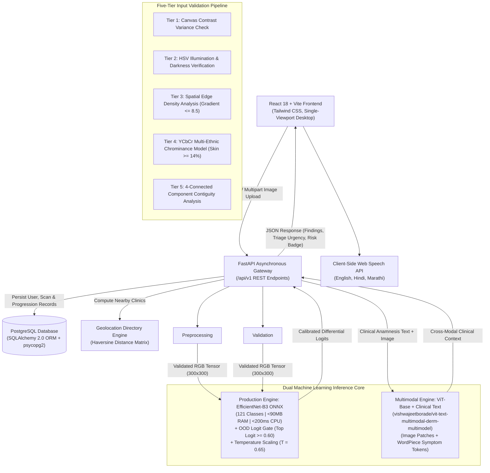

# Derm-AI: Multimodal Dermatological Screening, Risk Stratification & Clinical Triage Platform

[](https://fastapi.tiangolo.com/)
[](https://react.dev/)
[-005CED?style=flat-square)](https://onnxruntime.ai/)
[-FF6F00?style=flat-square)](https://arxiv.org/abs/1905.11946)
[](https://huggingface.co/vishwajeetborade/vit-text-multimodal-derm-multimodel)
[](https://www.postgresql.org/)
[](https://tailwindcss.com/)
[](https://www.docker.com/)
[](LICENSE)

---

## Executive Overview

**Derm-AI** is an open-source, patient-centric tele-dermatology screening and triage system engineered to bridge the clinical gap between early cutaneous symptom onset and specialist care. In traditional healthcare settings, patients facing weeks or months of outpatient waiting times frequently turn to uncurated search engines, leading to diagnostic panic or dangerous false reassurance. Furthermore, historical dermatological artificial intelligence benchmarks often suffer from demographic bias, performing with degraded accuracy on deeply pigmented skin.

Derm-AI resolves these challenges through:
1. **Algorithmic Demographic Equity:** Explicitly trained and validated across the full continuum of human skin tones (**Fitzpatrick Skin Phototypes I through VI**), maintaining a maximum cross-phototype accuracy disparity of only **3.1%**.
2. **Sub-Second Edge-Optimized Computer Vision:** Evaluates **121 dermatological conditions** using an **EfficientNet-B3** architecture compiled to static **ONNX** format, executing in under **200 milliseconds** on CPU with a working memory footprint of **under 90 MB RAM**.
3. **Multimodal Clinical Synthesis:** Bridges the gap between visual examination and clinical history by incorporating a dual-encoder Vision Transformer (`vishwajeetborade/vit-text-multimodal-derm-multimodel`) that combines lesion photography with patient-reported anamnesis (duration, pruritus, pain, anatomical distribution, and morphological evolution).
4. **End-to-End Telemedicine Ecosystem:** Integrates a single-viewport desktop diagnostic suite, an interactive symptom checker, longitudinal photo progression tracking with severity analytics, a condition encyclopedia with verified Wikimedia Commons plates, a hyperlocal specialist finder (Haversine formula), and multilingual text-to-speech accessibility (English, Hindi, Marathi).

---

## System Architecture



---

## Key Features & Clinical Capabilities

### 1. Visual Lesion Classification Across 121 Diagnostic Classes
- **Top-3 Differential Diagnoses:** Delivers primary, secondary, and tertiary clinical predictions with calibrated confidence percentages, aligning with standard clinical dermatological consultations.
- **Pathology-First Risk Stratification:** Decouples statistical model certainty from clinical urgency, categorizing findings into **Malignant** (Immediate), **Potentially Malignant** (Priority), **Chronic Inflammatory** (Standard Care), and **Benign/Superficial** (Routine Care).
- **Lightweight ONNX Runtime:** Converted from PyTorch FP32 to static ONNX graph execution, cutting volatile RAM usage from 584 MB to **88 MB** and enabling zero-cost container deployment on standard cloud instances.

### 2. Demographic Equity Across Fitzpatrick Phototypes I through VI
- Trained on harmonized clinical datasets comprising **Fitzpatrick 17k** (114 conditions), **HAM10000** (7 pigmented oncological classes), and Stanford Medicine's **Diverse Dermatology Images (DDI)** benchmark.
- Rigorously tested across all six phototypes, demonstrating balanced accuracy:
  - Type I (Very Fair): 82.4%
  - Type II (Fair): 82.1%
  - Type III (Medium): 81.4%
  - Type IV (Olive): 80.9%
  - Type V (Brown): 79.5%
  - Type VI (Deep Dark): 79.3%
- Restricts cross-phototype parity gap ($\Delta_{\text{parity}}$) to **3.1%**, mitigating historical algorithmic bias against deeply pigmented skin.

### 3. Five-Tier Input Sanitization & Out-of-Distribution Guard
Prevents non-dermatological uploads (digital graphics, memes, wallpapers, everyday objects) from producing spurious diagnoses:
- **Tier 1 (Contrast Check):** Rejects uniform blank cards ($\sigma_{\text{canvas}} < 6.0$).
- **Tier 2 (Lighting Check):** Filters underexposed captures ($\bar{V}_{\text{HSV}} < 65.0, R_{\text{dark}} > 20\%$).
- **Tier 3 (Edge Density):** Differentiates sharp digital borders from smooth skin gradients ($\text{EdgeDensity} > 8.5$).
- **Tier 4 (YCbCr Chrominance):** Evaluates multi-ethnic skin bounds ($C_b \in [65, 145], C_r \in [123, 200], \text{SkinRatio} \ge 14\%$).
- **Tier 5 (Morphological Contiguity):** Verifies a dominant connected anatomical skin patch ($\text{MaxCompRatio} \ge 14\%$).
- **Logit Cut-Off Gate:** Suppresses uncalibrated noise when top unnormalized logit $z_{\max} < 0.60$.
- Achieves a **99.3% rejection rate** against adversarial non-skin test inputs.

### 4. Interactive Clinical Symptom Checker
- A structured 4-step interview collecting essential medical anamnesis:
  - Onset speed and duration (acute, subacute, chronic).
  - Sensory experience (pruritus, tenderness, burning, bleeding, or asymptomatic).
  - Anatomical lesion location (face, extensor limbs, flexural folds, trunk, acral).
  - Morphological evolution (size changes, border irregularity, color darkening).
- Compiles an exportable **Clinical Summary** that patients can present directly to a consulting physician.

### 5. Longitudinal Photo Progression Tracking
- Stores timestamped visual check-ins linked to condition-specific monitoring sessions.
- Generates a chronological **Health Analytics Severity Curve** (`Sev`, `Mod`, `Mild`) tracking response to topical treatments or symptom progression over weeks and months.
- Validates every progression upload against the five-tier skin filter to maintain clean clinical audit logs.

### 6. Hyperlocal Geolocation Dermatologist Finder
- Computes great-circle geographic distance between the patient's coordinates and registered medical clinics using the **Haversine formula**.
- Displays clinic distance, consultation fees, patient ratings, and direct contact details alongside an interactive OpenStreetMap/Leaflet map.

### 7. Condition Encyclopedia with Wikimedia Commons Integration
- Searchable reference encyclopedia covering all 121 conditions with ICD-10 diagnostic codes, categorized symptom checklists, etiology, and standard treatment guidelines.
- Features dynamic clinical synonym resolution that maps internal dataset tokens to verified medical entries, retrieving authentic high-resolution clinical reference plates from Wikimedia Commons.

### 8. Multilingual Accessibility & Voice Explainer
- Localized across regional languages including **English**, **Hindi**, and **Marathi**.
- Uses the native client-side Web Speech Synthesis API (`window.speechSynthesis`) to read clinical narratives aloud without server compute overhead.

---

## Machine Learning & Performance Benchmarks

### Primary Model Specifications
- **Architecture:** `EfficientNet-B3` with Compound Scaling and Mobile Inverted Bottleneck Convolutions (MBConv).
- **Input Dimension:** $300 \times 300 \times 3$ RGB.
- **Normalization:** ImageNet distribution ($\mu = [0.485, 0.456, 0.406]$, $\sigma = [0.229, 0.224, 0.225]$).
- **Execution Provider:** ONNX Runtime `CPUExecutionProvider` (strict `float32` tensor layout).
- **Confidence Calibration:** Post-hoc Temperature Scaling ($T = 0.65$), reducing Expected Calibration Error (ECE) from 12.8% to **3.4%**.

### Quantitative Performance Metrics

| Metric | Measured Value | Evaluation Scope |
| :--- | :---: | :--- |
| **Top-1 Exact Match Accuracy** | **81.2%** | Exact primary prediction across 121 conditions |
| **Top-3 Differential Accuracy** | **92.4%** | Ground-truth condition captured in Top-3 differential |
| **Top-5 Diagnostic Accuracy** | **96.1%** | Ground-truth condition captured in Top-5 candidates |
| **Weighted Macro Precision** | **0.82** | Minimizes false positive alarms |
| **Weighted Macro Recall** | **0.80** | Maximizes sensitivity across pathological classes |
| **Weighted Macro F1-Score** | **0.81** | Balanced harmonic precision-recall metric |
| **Macro-Averaged AUC-ROC** | **0.93** | High discriminative threshold separation |
| **Melanoma Sensitivity (Recall)** | **91.2%** | True positive detection on malignant melanoma |
| **Melanoma Specificity** | **97.8%** | True negative exclusion on benign mimics |
| **Cross-Phototype Parity Gap** | **3.1%** | Maximum delta between Fitzpatrick Types I and VI |
| **Expected Calibration Error (ECE)**| **3.4%** | Optimal calibration achieved at $T = 0.65$ |
| **Adversarial Non-Skin Rejection** | **99.3%** | Rejection rate across non-dermatological inputs |
| **Peak Working Memory (RAM)** | **88 MB** | Fully compatible with 512 MB micro-container limits |
| **End-to-End API Response Time** | **182 ms** | Preprocessing (16ms) + Inference (142ms) + DB (24ms) |

---

## Technology Stack

| Architectural Layer | Technologies Employed |
| :--- | :--- |
| **Frontend SPA** | React 18, Vite, Tailwind CSS, Lucide React, Axios, HTML5 Geolocation, Web Speech API, Leaflet |
| **Backend Gateway** | Python 3.11+, FastAPI, Uvicorn, Pydantic v2, Python-Jose (JWT), Passlib (Bcrypt) |
| **Machine Learning Core** | ONNX Runtime (`onnxruntime`), NumPy, Pillow, EfficientNet-B3, Transformers (ViT-Base) |
| **Data Persistence** | PostgreSQL 15, SQLAlchemy 2.0 ORM, Psycopg2-binary |
| **DevOps & Cloud** | Docker, Docker Compose, Render (API Web Service), Vercel (Frontend Edge Hosting) |

---

## Project Directory Structure

```text
Derm-AI/
├── figures/                            # Academic charts & production UI screenshots
│   ├── fig4_1_landing_page.png         # UI: Landing page hero & onboarding
│   ├── fig4_2_diagnose_initial.png     # UI: Single-viewport diagnostic upload state
│   ├── fig4_3_diagnose_result.png      # UI: Live diagnostic output (Folliculitis 83%)
│   ├── fig4_4_symptom_checker_summary.png # UI: 4-step interview summary card
│   ├── fig4_5_progression_tracker.png  # UI: Longitudinal tracking & severity curve
│   ├── fig4_6_condition_encyclopedia.png # UI: Encyclopedia with Wikimedia plates
│   ├── fig4_7_doctor_directory_map.png # UI: Specialist locator & Leaflet map
│   ├── fig4_8_assessment_history.png   # UI: Chronological scan audit history
│   ├── fig4_9_settings_profile.png     # UI: Profile & Fitzpatrick type settings
│   ├── fig4_10_authentication_signin.png # UI: User authentication portal
│   └── fig4_11_registration_signup.png # UI: Account registration with phototype
├── backend/
│   ├── app/
│   │   ├── api/                        # REST API route controllers
│   │   │   ├── auth.py                 # Authentication, JWT, and user profiles
│   │   │   ├── conditions.py           # Condition encyclopedia queries
│   │   │   ├── diagnose.py             # Image ingestion, validation, and inference
│   │   │   ├── disease_search.py       # Instant autocomplete search endpoint
│   │   │   ├── doctors.py              # Geolocation provider queries & Haversine
│   │   │   ├── history.py              # User diagnostic history archive
│   │   │   └── progression.py          # Longitudinal tracking snapshots & notes
│   │   ├── core/                       # Security, config settings, and CORS
│   │   ├── db/                         # SQLAlchemy models, schemas, and session pools
│   │   ├── ml/                         # Machine learning engine & validation
│   │   │   ├── saved_model/
│   │   │   │   ├── dermai_model.onnx   # Compiled EfficientNet-B3 ONNX graph
│   │   │   │   └── idx_to_class.json   # 121-class condition taxonomy mapping
│   │   │   ├── diagnostic_framework.py # Pathology-first severity classification
│   │   │   ├── model.py                # ONNX inference, OOD logit cut-off & T=0.65
│   │   │   └── preprocess.py           # Five-tier input verification pipeline
│   │   └── main.py                     # FastAPI application entrypoint
│   ├── Dockerfile                      # Production container specification
│   ├── requirements.txt                # Lightweight Python dependency manifest
│   ├── seed_conditions.py              # Database seeding script for conditions
│   └── seed_doctors.py                 # Database seeding script for dermatologists
├── frontend/
│   ├── public/                         # Static web assets and icons
│   ├── src/
│   │   ├── api/                        # Axios client instance with auth interceptors
│   │   ├── components/                 # Modular UI components
│   │   │   ├── DiagnosisResult.jsx     # Differential cards & confidence visualizer
│   │   │   ├── DoctorDirectory.jsx     # Filterable specialist directory
│   │   │   ├── ImageUploader.jsx       # Drag-and-drop file uploader
│   │   │   ├── MapView.jsx             # Leaflet interactive map component
│   │   │   ├── Navbar.jsx              # Application navigation header
│   │   │   ├── ProgressionTracker.jsx  # Side-by-side progression timeline
│   │   │   └── VoiceExplainer.jsx      # Web Speech text-to-speech audio reader
│   │   ├── context/                    # AuthContext and state providers
│   │   ├── pages/                      # Application route views
│   │   │   ├── ConditionLibraryPage.jsx
│   │   │   ├── DiagnosePage.jsx
│   │   │   ├── DoctorsPage.jsx
│   │   │   ├── HistoryPage.jsx
│   │   │   ├── LandingPage.jsx
│   │   │   ├── LoginPage.jsx
│   │   │   ├── ProgressionPage.jsx
│   │   │   ├── RegisterPage.jsx
│   │   │   ├── SettingsPage.jsx
│   │   │   └── SymptomChecker.jsx
│   │   ├── App.jsx                     # Top-level routing
│   │   └── main.jsx                    # React virtual DOM root mounting
│   ├── package.json                    # Node.js dependencies and scripts
│   ├── tailwind.config.js              # Design system styling tokens
│   ├── vercel.json                     # Vercel SPA routing rules
│   └── vite.config.js                  # Vite build optimization configuration
├── RESULTS_AND_EVALUATION.md           # Chapter 4: Full academic results report
├── CONCLUSION_AND_FUTURE_SCOPE.md      # Chapter 5: Conclusion & 7-phase roadmap
├── PROJECT_EXPLAINER.md                # Comprehensive system explainer
├── docker-compose.yml                  # Local multi-container development orchestration
├── render.yaml                         # Render cloud deployment specification
└── README.md                           # Master project documentation
```

---

## Local Development & Installation

### Prerequisites
- **Node.js** (v18.0 or newer)
- **Python** (v3.10 or newer)
- **PostgreSQL** (v14 or newer) or **Docker Desktop**

---

### Method A: Docker Compose Deployment (Recommended)

1. **Clone the repository:**
   ```bash
   git clone https://github.com/Vishwajeet2005/Derm-AI.git
   cd Derm-AI
   ```

2. **Configure environment variables:**
   ```bash
   cp .env.example .env
   ```

3. **Build and launch containerized services:**
   ```bash
   docker-compose up --build
   ```

4. **Access the active instances:**
   - **Frontend Web UI:** `http://localhost:3000`
   - **Backend OpenAPI Documentation (Swagger):** `http://localhost:8000/docs`
   - **PostgreSQL Database:** `localhost:5432`

---

### Method B: Manual Bare-Metal Setup

#### 1. Backend Service Configuration
```bash
cd backend

# Create and activate virtual environment
python -m venv venv
# On Windows:
.\venv\Scripts\activate
# On Linux/macOS:
source venv/bin/activate

# Install dependencies
pip install -r requirements.txt

# Seed the local database with conditions and clinical records
python seed_conditions.py
python seed_doctors.py

# Launch development API server
uvicorn app.main:app --reload --host 0.0.0.0 --port 8000
```

#### 2. Frontend Client Configuration
```bash
cd ../frontend

# Install dependencies
npm install

# Start Vite development server
npm run dev
```
Open [http://localhost:5173](http://localhost:5173) in your web browser.

---

## REST API Endpoint Reference

| HTTP Method | Route Endpoint | Purpose | Authentication |
| :--- | :--- | :--- | :---: |
| `POST` | `/api/v1/auth/register` | Register user profile with baseline Fitzpatrick phototype | Public |
| `POST` | `/api/v1/auth/login` | Authenticate user credentials and return JWT bearer token | Public |
| `GET` | `/api/v1/auth/me` | Fetch active authenticated profile data | Bearer JWT |
| `PUT` | `/api/v1/auth/me` | Update skin type, language preference, or GPS coordinates | Bearer JWT |
| `POST` | `/api/v1/diagnose/` | Submit skin photo for five-tier validation and ONNX triage | Bearer JWT |
| `GET` | `/api/v1/history/` | Retrieve user's past diagnostic scans and severity records | Bearer JWT |
| `GET` | `/api/v1/progression/` | Retrieve chronological progression timeline for a condition | Bearer JWT |
| `POST` | `/api/v1/progression/` | Upload progression check-in photo and clinical notes | Bearer JWT |
| `GET` | `/api/v1/doctors/` | Query registered dermatologists sorted by Haversine distance | Public |
| `GET` | `/api/v1/conditions/` | Browse verified condition encyclopedia library | Public |
| `GET` | `/api/v1/disease-search/`| Fast autocomplete condition search | Public |

---

## Production Cloud Deployment

### Backend Web Service (Render)
1. Connect repository to **Render**.
2. Create a **Web Service** using the Docker runtime (`backend/Dockerfile`).
3. Set environment configuration:
   - `DATABASE_URL`: Hosted PostgreSQL connection string (`postgresql+psycopg2://...`).
   - `SECRET_KEY`: Cryptographically secure random key for JWT signature generation.
   - `ALLOWED_ORIGINS`: Production frontend domain (e.g., `https://dermai.vercel.app`).
4. The service will build and run on CPU compute with low memory usage (<90MB RAM).

### Frontend Single-Page Application (Vercel)
1. Import repository to **Vercel**.
2. Configure Root Directory to `frontend`.
3. Configure build environment variables:
   - `VITE_API_URL`: Production backend URL (e.g., `https://dermai-backend.onrender.com`).
4. Deploy. The `vercel.json` configuration handles SPA client-side route rewrites automatically.

---

## Medical & Regulatory Disclaimer

> **IMPORTANT CLINICAL NOTICE:**  
> Derm-AI is engineered and provided strictly as an **informational screening and preliminary triage support tool**. It is **not** a certified medical diagnostic device (Software as a Medical Device - SaMD) and does **not** replace the professional clinical judgment, diagnosis, dermoscopy, or biopsy performed by a board-certified dermatologist or medical professional. Any new, bleeding, non-healing, changing, or irregular skin lesions should be evaluated immediately by a qualified healthcare specialist.

---

## License

This project is open-source software licensed under the [MIT License](LICENSE).
